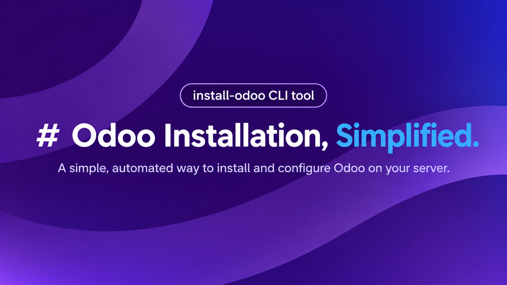

<p align="center">
  
</p>

<p align="center">
  <a href="https://www.npmjs.com/package/install-odoo"></a>
  <a href="https://www.npmjs.com/package/install-odoo"></a>
  
  
  <a href="LICENSE"></a>
</p>

# Install Odoo CLI

Install and configure a production-ready **Odoo 17, 18, 19 or 20** on an Ubuntu server with a single command.

```bash
sudo npx install-odoo
```

## Features

- **Guided or unattended.** Answer a few prompts, or pass a JSON file for a non-interactive install.
- **Community or Enterprise.** Enterprise needs a GitHub token that can read `odoo/enterprise`.
- **Runs as a native systemd service.** It starts at boot and is restarted automatically if Odoo crashes or gets OOM-killed. The installer waits until Odoo answers on `/web/health` before it reports success.
- **Sized for your server.** `workers`, `max_cron_threads` and `limit_memory_*` are calculated from the CPU and RAM of the machine.
- **Everything around Odoo.** PostgreSQL 16, an isolated Python virtualenv, `wkhtmltopdf`, log rotation, and optionally an Nginx reverse proxy with a free Let's Encrypt certificate.
- **`doctor` command.** Diagnoses an existing installation and repairs the common problems (see [Doctor](#doctor)).

## Requirements

- Ubuntu **22.04** or **24.04** (amd64 or arm64), and root access: run the CLI with `sudo`.
  Odoo **20.0** requires Python 3.12, so it can only be installed on Ubuntu **24.04**; the CLI stops before changing anything on 22.04.
- Node.js **18.18** or newer with npm. If they are missing:

  ```bash
  sudo apt install nodejs npm -y
  ```

## Quick start

```bash
sudo npx install-odoo
```

You will be asked for the options below, shown a summary, and asked to confirm before anything is changed.
Add `--dry-run` to see every command without running it.

### Prompts

| Prompt | Default | Notes |
| --- | --- | --- |
| Odoo version | `19.0` | `20.0`, `19.0`, `18.0` or `17.0`. Odoo 20.0 needs Ubuntu 24.04 or newer (it requires Python 3.12) and PostgreSQL 16 or newer. |
| Odoo Enterprise | No | Asks for a GitHub access token with access to `odoo/enterprise`. |
| Odoo home directory | `/odoo` | Absolute path, must not exist yet. |
| System user | `odoo` | Created if missing. The service is named `<user>-server`. |
| Super admin password | generated | A strong random password is written to the config file. Or type your own (8+ characters). |
| HTTP port / websocket port | `8069` / `8072` | Must be different. |
| Install PostgreSQL 16 | Yes | Uses the official PostgreSQL apt repository. |
| PostgreSQL host / port | `localhost` / `5432` | Use another host to connect to an existing database server. |
| PostgreSQL user / password | Odoo user / required | The role is created with `CREATEDB` when PostgreSQL is local. |
| Install `wkhtmltopdf` | Yes | Patched Qt build 0.12.6.1-3, required for PDF reports. |
| Install Nginx | No | Asks for the website name (`_` for any host). |
| Enable SSL | Yes for a real domain | Let's Encrypt through Certbot. Needs the domain's DNS to point at the server, and an email address. |

### Unattended install

Every key is optional except the passwords and falls back to the prompt defaults:

```json
{
  "version": "18.0",
  "odooHome": "/odoo",
  "odooUser": "odoo",
  "pgPassword": "change-me",
  "nginx": true,
  "websiteName": "erp.example.com",
  "ssl": true,
  "sslEmail": "admin@example.com"
}
```

```bash
sudo npx install-odoo --config install.json --yes
```

For Enterprise add `"isEnterprise": true` and `"accessToken": "<token>"`, or export `ODOO_GITHUB_TOKEN`.
Set `"strongPassword": false` together with `"adminPassword"` to choose the super admin password yourself.

| Option | Description |
| --- | --- |
| `--dry-run` | Print the actions without executing them. |
| `--config <file>` | Read all answers from a JSON file instead of prompting. |
| `-y`, `--yes` | Do not ask for confirmation before installing. |

## What gets installed

For the defaults (user `odoo`, home `/odoo`):

| What | Where |
| --- | --- |
| Odoo source | `/odoo/odoo-server` |
| Enterprise addons (optional) | `/odoo/enterprise` |
| Your custom addons | `/odoo/custom/addons` (every other folder in `/odoo/custom` is added to `addons_path` too) |
| Python virtualenv | `/odoo/venv` |
| Configuration | `/etc/odoo-server.conf` (readable by the Odoo user only; holds the generated super admin password) |
| systemd service | `/etc/systemd/system/odoo-server.service` |
| Odoo log | `/var/log/odoo/odoo-server.log` (rotated daily, 30 days kept) |
| Nginx site (optional) | `/etc/nginx/sites-available/<website>.conf` |
| Installation summary | `/tmp/odoo-install-summary.md` |

Show the generated super admin password with `sudo grep admin_passwd /etc/odoo-server.conf`.

## Managing the service

```bash
sudo systemctl status odoo-server        # state
sudo systemctl restart odoo-server       # restart after changing the config or custom addons
sudo journalctl -u odoo-server -f        # systemd journal
tail -f /var/log/odoo/odoo-server.log    # Odoo log
```

Replace `odoo` with the system user you chose. `workers` and the memory limits live in `/etc/<user>-server.conf`: adjust
them there if your workload needs it, then restart the service.

## Doctor

`doctor` checks an existing installation and can repair the common problems. This includes servers installed with
`install-odoo` 1.0.x, which used an init.d script that left the service "active" after Odoo had died.

```bash
sudo npx install-odoo doctor          # report only
sudo npx install-odoo doctor --fix    # repair what can be repaired automatically
```

| Check | What it looks for |
| --- | --- |
| Service definition | A legacy init.d script, or a unit that does not restart Odoo after a crash. |
| Service state | A service that is "active (exited)", failed, or restarting repeatedly. |
| HTTP health | Whether `/web/health` answers on the configured port. |
| Workers and limits | `workers = 0` (threaded mode) or missing memory and time limits. |
| Logs | Missing log rotation, a huge log file, a nearly full disk. |
| Permissions | The Odoo user in the `sudo` group, a venv or log directory with the wrong owner. |
| PostgreSQL | The service running and the credentials from the config working. |
| Nginx | Websocket proxy without HTTP/1.1, no upload size limit, `Secure` cookies without SSL. |
| `wkhtmltopdf` | Installed or not. |
| Out of memory | Odoo processes killed by the kernel in the last 30 days. |

Fixes back up every file they change and never overwrite values you set yourself. Other options:
`--user <name>` to pick an installation when there are several, `--yes` to skip the confirmation, `--dry-run`.
The exit code is `1` while a check is failing, so it can run from a monitoring job.

## Troubleshooting

- **Odoo is not reachable after the install.** Run `sudo npx install-odoo doctor`, then
  `sudo journalctl -u odoo-server -n 100`.
- **Odoo stops by itself.** Run `doctor`: it reports kernel OOM kills and fixes missing worker and memory limits.
  A server with very little RAM may also need swap.
- **SSL could not be enabled.** The certificate request needs the domain's DNS to point at the server. Fix the DNS,
  then run `sudo certbot --nginx -d <your-domain>`.
- **PDF reports have no header or footer.** Install `wkhtmltopdf` from this CLI (Odoo needs the patched Qt build,
  not the one in the Ubuntu repositories).

## Development

```bash
pnpm install
pnpm dev --dry-run               # run from source without changing the system
pnpm typecheck && pnpm test && pnpm build
```

### Releasing

The package is published from GitHub Actions with [npm Trusted Publishing](https://docs.npmjs.com/trusted-publishers)
(no npm token is stored). Bump `version` in `package.json`, commit, then push a matching tag:

```bash
git tag v1.2.0 && git push origin v1.2.0
```

## License

This project is licensed under the MIT License - see the [LICENSE](LICENSE) file for details.

## Support

If you encounter any problems or have suggestions for improvements, please submit an
[issue](https://github.com/HeliconiaIO/install-odoo/issues) on our GitHub repository. Your feedback is valuable to us!

## About

**Heliconia Solution Pvt. Ltd.**  
[Odoo Partner and Implementor](https://www.heliconia.io)

Specializes in end-to-end Odoo implementation, development, integration, customization, and support. We ensure seamless
onboarding, agile development, and reliable post-implementation support, empowering businesses worldwide to optimize
operations and drive growth with tailored ERP solutions across industries.
